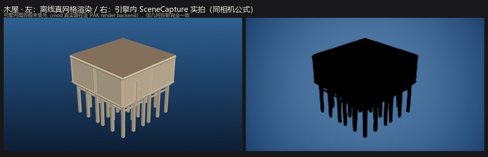
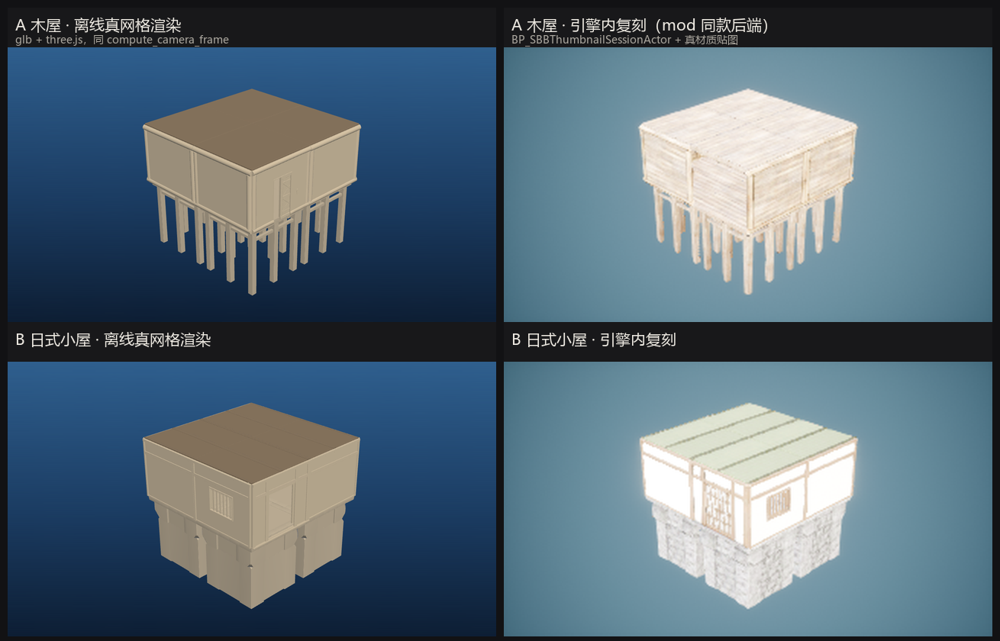

# render/ - 离线缩略图渲染页面

## 摘要

`render/` 提供离线出缩略图的渲染页面：读一份 schema-9 蓝图与 `meshes/` 里的真网格，按 mod 的相机公式用 three.js 画出来，再由 `tooling/render_offline.mjs` 经本机 Chrome 截成 PNG。你可以在不启动游戏的情况下检查体量、层数、轮廓与开口位置是否符合预期。边界：出图是「真网格 + 类型色」，几何与取景对齐游戏内，材质与光照不代表游戏内观感。启动命令与 Chrome 端点由 [tooling/README.md](../tooling/README.md) 拥有，本页只写页面契约与保真度证据。

## 目录

- [怎么用](#怎么用)
- [保真度与对照证据](#保真度与对照证据)
- [失败与恢复](#失败与恢复)
- [了解实现](#了解实现)
- [限制](#限制)
- [Further Exploration](#further-exploration)
- [Dev Note](#dev-note)

-----

## 怎么用

渲染页面没有自己的 CLI：`tooling/render_offline.mjs` 起一个本地静态服务，把蓝图路径、id→BP 映射、actor 偏移与网格目录拼成查询参数传给 `render/modsrender.html`，再通过 Chrome DevTools 协议截图并写 PNG（源码：[render_offline.mjs](../tooling/render_offline.mjs)）。命令与 9222 端点的启动方式见 [tooling/README.md](../tooling/README.md)；下面是页面实际接受的参数（默认值取自源码）。

| 参数 | 默认 | 作用 |
|---|---|---|
| `bp` | 必填 | 要渲染的 schema-9 JSON 路径（服务根是仓库根） |
| `idmap` | `/meshes/_id_to_bp.json` | BuildObjectId → 蓝图名，决定加载哪个 GLB |
| `offsets` | `/meshes/_actor_offsets.json` | 每类 `actor_relative_to_model` 的平移与旋转 |
| `meshes` | `/meshes` | GLB 目录 |
| `w` / `h` | `1280` / `720` | 截图尺寸；取景距离仍按 mod 的 320×180 竖直比例计算 |

一次运行的判定看脚本最后那行 JSON：`ok`、`output`、`status`。`status` 里是 `pieces`、`placed`、`missing`、`camera`、`bbox`：`ok: true` 只表示渲染流程跑完，图是否完整要看 `missing` 是否为空。以上字段按源码核对；本机没有 9222 端点，未实跑（见 [限制](#限制)）。

## 保真度与对照证据

相机不是估出来的：页面逐行移植了 mod 的 `BlueprintThumbnailRenderer.compute_camera_frame`。常量与出处都在冻结研究 [mod_render_notes.md](../archive/research/mod_render_notes.md)：那份记录从 mod 的 `BlueprintThumbnailRenderer.lua` 拆出逐行管线——水平 FOV **40°**、取景填充 `FRAME_FILL = 0.86`、固定机位方向 `normalize(4.2, 4.2, -3.0)`、包围盒 8 个角点求相机距离（下限 100 cm）、`SceneCaptureComponent2D` 出 320×180 渲染目标、缩略图落盘到 `%LOCALAPPDATA%\SimpleBuildingBlueprints`。页面按同一公式在 three.js 里重建：蓝图厘米、GLB 米（缩放 100），轴映射 UE `(x, y, z)` → three `(x, z, -y)`。该记录同时写明离线复刻已知的 3 处差异：没有贴图（只能用类型色）、缺 6 件 Fence、anchor 的世界旋转默认不施加。以上事实以那份归档记录为准，本页只引用不复述推导。

为什么是「真网格 + 类型色」：从 pak 导出的 GLB 不含贴图（images: 0），顶点色 `COLOR_0` 偏黑，直接用会得到一团黑块。页面因此按构件族上固定色（屋顶、地基、墙/窗/门、楼梯、柱、玻璃），保证轮廓可读，代价是不能用颜色判断游戏内材质。相机与几何一致、外观不一致，就是下面这些对照图要说明的事。

| 对照图 | 它证明什么 |
|---|---|
| [compare_hut_offline_vs_inengine.png](compare/compare_hut_offline_vs_inengine.png) | 同一相机公式下，左为离线真网格渲染、右为引擎内 SceneCapture 实拍。图内标题写明「引擎内图目前未受光（mod 真实路径走 PAK render backend），但几何投影完全一致」：轮廓、檐口、支柱位置逐一对上，差异只在着色。 |
| [compare_offline_vs_inengine_grid.png](compare/compare_offline_vs_inengine_grid.png) | 木屋（A）与日式小屋（B）两行：左列离线真网格、右列引擎内复刻（同款 session actor + 真材质贴图）。同机位几何一致；左列是类型色、右列是游戏材质——这就是「材质不代表观感」的直接证据。 |
| [compare_basic_realmesh.png](compare/compare_basic_realmesh.png) | Basic Base（313 件）：左为 mod 引擎内渲染，右为离线真网格渲染（同相机、无贴图）。两翼楼体、中庭、楼梯与石柱围栏的布局和体量对齐。 |
| [compare_basic_base_mod_vs_offline.png](compare/compare_basic_base_mod_vs_offline.png) | 更早的 Basic Base 对照：左 mod 渲染、右离线代理体块。取景与体量对得上，但代理只到方块级；真网格渲染补齐了轮廓。 |
| [compare_grover_mod_vs_offline.png](compare/compare_grover_mod_vs_offline.png) | Grover's First House（262 件）的同类对照：左 mod 渲染、右离线代理，角度与占画幅一致。 |

## 失败与恢复

失败都出在「页面拿不到输入」或「Chrome 端点不在」。`connect ECONNREFUSED 127.0.0.1:9222` 由前序文档作者在本机观测；其余行按源码核对，未逐条复现。

| 现象 | 原因 | 处理 |
|---|---|---|
| `connect ECONNREFUSED 127.0.0.1:9222` | 本机没有 Chrome 调试端点 | 按 [tooling/README.md](../tooling/README.md) 起端点后重跑；不影响蓝图交付 |
| `no page target on 9222` | 端点已启动，但没有可用的 page 目标 | 在 Chrome 里打开任一页面后重跑 |
| `status.missing` 非空 | `meshes/` 没导出该 BuildObjectId 对应的 GLB | 补导出该类型网格；缺件只影响该件显示，`ok` 仍可能为 true |
| `status.error` 有内容 | 蓝图层路径或 `_id_to_bp.json` / `_actor_offsets.json` 读不到（fetch 4xx） | 检查 `bp` 路径，确认 `meshes/` 下两个清单文件存在 |

## 了解实现

实现内部 - 点击展开

链路是「静态服务 + 浏览器内 three.js + CDP 截图」：本机起一个只读静态服务把仓库当根目录；页面按参数加载蓝图、id 映射与 actor 偏移，逐个把 GLB 实例化到蓝图记录的世界变换上；包围盒由已放置对象的真实 AABB 求并，再套用 mod 的相机公式；渲染完成后页面设置 `window.__renderDone` 与 `window.__renderStatus`，脚本轮询到标记后截图退出。多部件构件（如门叶 + 门框）按 `meshes/_parts.json` 逐个部件加载。

| 区域 | 源文件 | 职责 |
|---|---|---|
| 启动与截图 | [tooling/render_offline.mjs](../tooling/render_offline.mjs) | 起静态服务、拼页面 URL、连 9222、等渲染标记、写 PNG |
| 页面骨架 | [modsrender.html](modsrender.html) | 画布与 three.js importmap（`vendor/three.module.js`） |
| 场景与相机 | [modsrender.js](modsrender.js) | 载 GLB、套 actor 偏移、按 `compute_camera_frame` 取景、渲一次 |
| 网格与映射 | `meshes/` 下的 `_id_to_bp.json`、`_actor_offsets.json`、`_parts.json` 与 `.glb` | BuildObjectId → 蓝图名、模型偏移、多部件清单 |

## 限制

- 没有 `127.0.0.1:9222` 上的 Chrome 调试端点就不可用；本机探测连接超时，本页未复现，验证责任人：装有 Chrome 的工作区维护者。
- 颜色是按构件族上的类型色，材质与光照不是游戏内真实观感；验收只能看轮廓、层数、体量与开口位置。
- `meshes/_id_to_bp.json` 当前只映射 18 类，社区蓝图用到 49–55 类，未导出的 id 会在 `status.missing` 里列出，图不完整。
- anchor 的世界旋转默认不施加（只有 `?wrot=1` 才施加）；mod 在导入时渲缩略图用的锚点变换等价于蓝图相对坐标系，实测默认关闭才与 mod 缩略图一致。
- 社区样例的渲染图 `examples/community/reddit_grovers_first_house_render.png` 是从原工作区带过来的 Reddit 帖子内嵌图，不是本仓库重跑的产物。

-----

## Further Exploration

- [../tooling/README.md](../tooling/README.md) - 启动命令、Chrome 端点与退出码（命令的唯一 owner）。
- [../tooling/PalAssetExport/README.md](../tooling/PalAssetExport/README.md) - 从 pak 导出 GLB 与数据表的工具契约。
- [../examples/README.md](../examples/README.md) - 可拿来渲染的样本清单与校验结果。
- [../docs/agent-notes/AN-0001-offline-only.md](../docs/agent-notes/AN-0001-offline-only.md) - 为什么只做离线渲染。
- [../archive/research/mod_render_notes.md](../archive/research/mod_render_notes.md) - 冻结研究：mod 缩略图管线逐行证据与离线复刻边界。

## Dev Note

维护者工作记录 - 点击展开

本页行为与命令未在本机实跑（Chrome 9222 无监听，探测超时）；证据来自源码逐行核对与 `archive/research/mod_render_notes.md` 的既有实跑记录。待装有 Chrome 端点后补跑一次 `tooling/render_offline.mjs` 并回填 `status.missing` 的实际缺件名单。验证责任人：仓库维护者。

